<!-- Generated by src/build.ts. Edit src/content.ts instead. -->

<a href="https://zaebal.dev">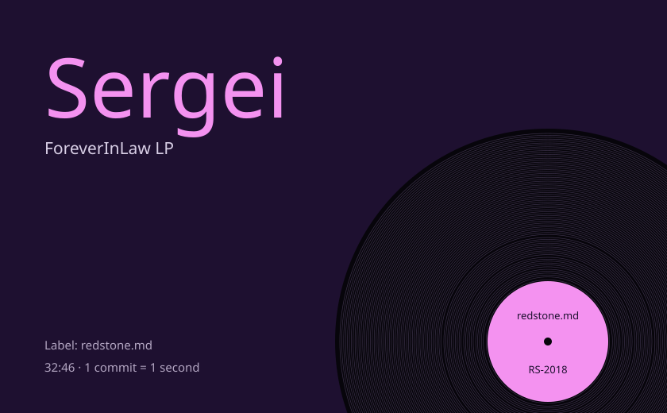</a>
<picture><source media="(prefers-color-scheme: light)" srcset="assets/side-a-light.svg" /></picture>
<a href="https://github.com/redstone-md/mosh-flutter"><picture><source media="(prefers-color-scheme: light)" srcset="assets/track-mosh-light.svg" />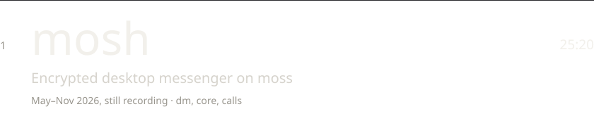</picture></a>
<a href="https://github.com/redstone-md/shield"><picture><source media="(prefers-color-scheme: light)" srcset="assets/track-shield-light.svg" />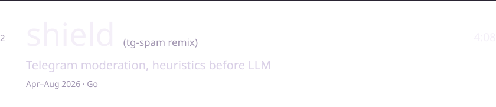</picture></a>
<picture><source media="(prefers-color-scheme: light)" srcset="assets/side-b-light.svg" /></picture>
<a href="https://github.com/redstone-md/flucord"><picture><source media="(prefers-color-scheme: light)" srcset="assets/track-flucord-light.svg" />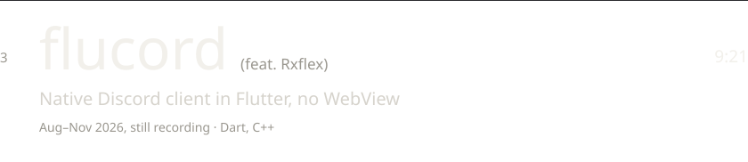</picture></a>
<a href="https://github.com/redstone-md/moss"><picture><source media="(prefers-color-scheme: light)" srcset="assets/track-moss-light.svg" />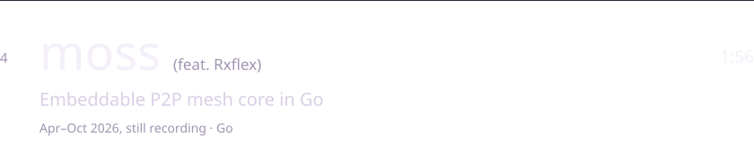</picture></a>
<a href="https://github.com/redstone-md/g3"><picture><source media="(prefers-color-scheme: light)" srcset="assets/track-g3-light.svg" />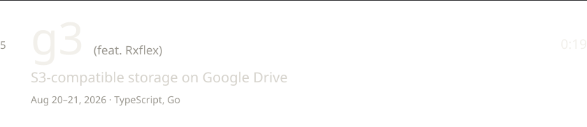</picture></a>
<picture><source media="(prefers-color-scheme: light)" srcset="assets/side-c-light.svg" />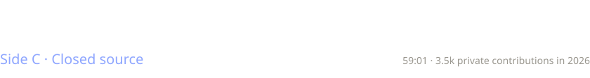</picture>
<a href="https://redstone.md/projects/launch-vpn"><picture><source media="(prefers-color-scheme: light)" srcset="assets/closed-launch-vpn-light.svg" /></picture></a>
<a href="https://redstone.md/projects/customerai"><picture><source media="(prefers-color-scheme: light)" srcset="assets/closed-customerai-light.svg" /></picture></a>
<a href="https://redstone.md/projects/balansear"><picture><source media="(prefers-color-scheme: light)" srcset="assets/closed-balansear-light.svg" /></picture></a>
<a href="https://redstone.md/projects/owork365"><picture><source media="(prefers-color-scheme: light)" srcset="assets/closed-owork365-light.svg" />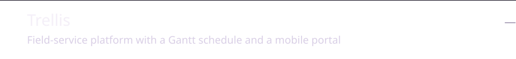</picture></a>
<a href="https://redstone.md/projects/crooked-arm-s-tma"><picture><source media="(prefers-color-scheme: light)" srcset="assets/closed-crooked-arm-s-tma-light.svg" />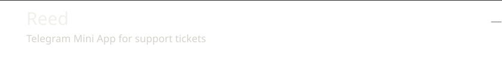</picture></a>
<picture><source media="(prefers-color-scheme: light)" srcset="assets/waveform-light.svg" />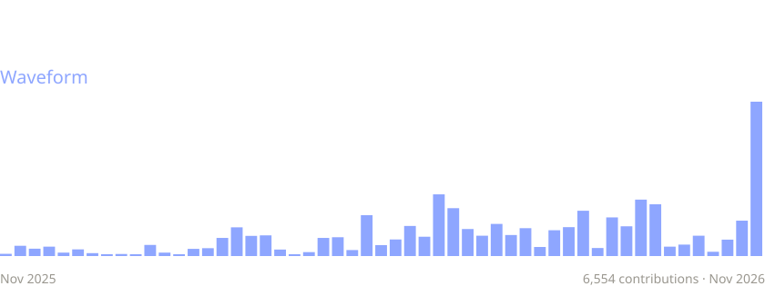</picture>
<picture><source media="(prefers-color-scheme: light)" srcset="assets/hours-light.svg" />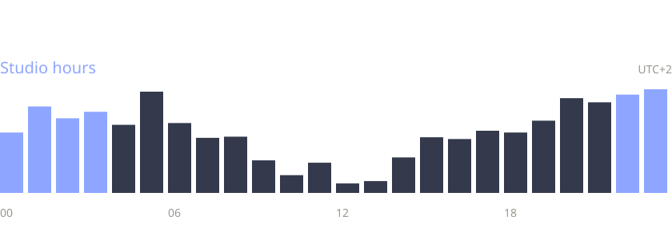</picture>
<picture><source media="(prefers-color-scheme: light)" srcset="assets/discography-light.svg" />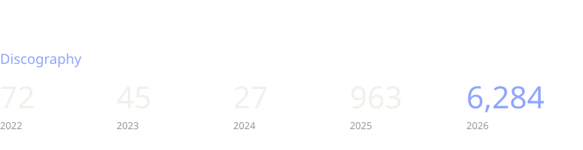</picture>
<picture><source media="(prefers-color-scheme: light)" srcset="assets/outtakes-light.svg" />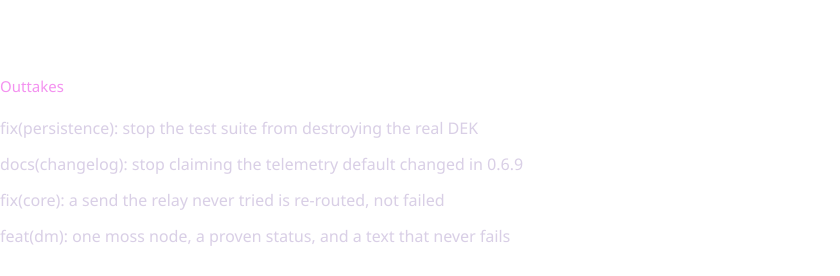</picture>
<picture><source media="(prefers-color-scheme: light)" srcset="assets/credits-light.svg" />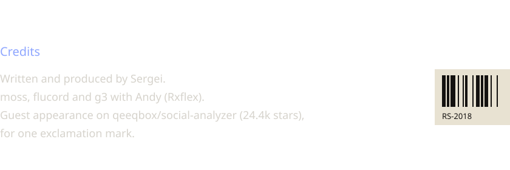</picture>

[zaebal.dev](https://zaebal.dev) · [@nevermorelove](https://t.me/nevermorelove) · [x@c0.md](mailto:x@c0.md)
