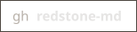
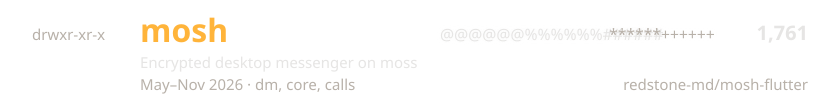
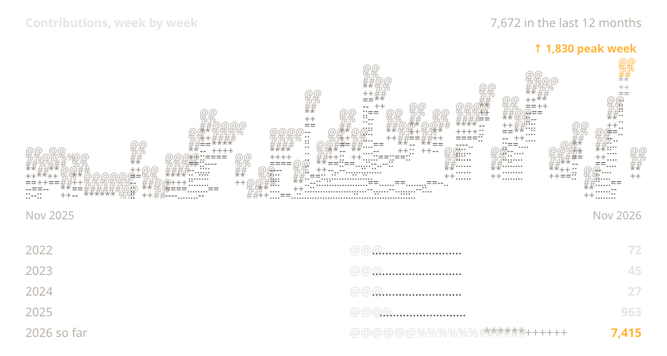
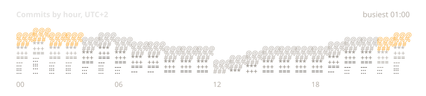

<!-- Generated by src/build.ts. Edit src/content.ts instead. -->

<a href="https://t.me/nevermorelove"><picture><source media="(max-width: 600px) and (prefers-color-scheme: light)" srcset="assets/cover-narrow-light.svg" /><source media="(max-width: 600px)" srcset="assets/cover-narrow-dark.svg" /><source media="(prefers-color-scheme: light)" srcset="assets/cover-wide-light.svg" /></picture></a>

<a href="https://t.me/nevermorelove"><picture><source media="(prefers-color-scheme: light)" srcset="assets/contact-tg-light.svg" /></picture></a>
<a href="mailto:x@c0.md"><picture><source media="(prefers-color-scheme: light)" srcset="assets/contact-mail-light.svg" /></picture></a>
<a href="https://zaebal.dev"><picture><source media="(prefers-color-scheme: light)" srcset="assets/contact-web-light.svg" /></picture></a>
<a href="https://github.com/redstone-md"><picture><source media="(prefers-color-scheme: light)" srcset="assets/contact-gh-light.svg" /></picture></a>

<picture><source media="(max-width: 600px) and (prefers-color-scheme: light)" srcset="assets/open-source-narrow-light.svg" /><source media="(max-width: 600px)" srcset="assets/open-source-narrow-dark.svg" /><source media="(prefers-color-scheme: light)" srcset="assets/open-source-wide-light.svg" /></picture>
<a href="https://github.com/redstone-md/mosh-flutter"><picture><source media="(max-width: 600px) and (prefers-color-scheme: light)" srcset="assets/track-mosh-narrow-light.svg" /><source media="(max-width: 600px)" srcset="assets/track-mosh-narrow-dark.svg" /><source media="(prefers-color-scheme: light)" srcset="assets/track-mosh-wide-light.svg" /></picture></a>
<a href="https://github.com/redstone-md/flucord"><picture><source media="(max-width: 600px) and (prefers-color-scheme: light)" srcset="assets/track-flucord-narrow-light.svg" /><source media="(max-width: 600px)" srcset="assets/track-flucord-narrow-dark.svg" /><source media="(prefers-color-scheme: light)" srcset="assets/track-flucord-wide-light.svg" /></picture></a>
<a href="https://github.com/redstone-md/shield"><picture><source media="(max-width: 600px) and (prefers-color-scheme: light)" srcset="assets/track-shield-narrow-light.svg" /><source media="(max-width: 600px)" srcset="assets/track-shield-narrow-dark.svg" /><source media="(prefers-color-scheme: light)" srcset="assets/track-shield-wide-light.svg" /></picture></a>
<a href="https://github.com/redstone-md/moss"><picture><source media="(max-width: 600px) and (prefers-color-scheme: light)" srcset="assets/track-moss-narrow-light.svg" /><source media="(max-width: 600px)" srcset="assets/track-moss-narrow-dark.svg" /><source media="(prefers-color-scheme: light)" srcset="assets/track-moss-wide-light.svg" /></picture></a>
<a href="https://github.com/redstone-md/g3"><picture><source media="(max-width: 600px) and (prefers-color-scheme: light)" srcset="assets/track-g3-narrow-light.svg" /><source media="(max-width: 600px)" srcset="assets/track-g3-narrow-dark.svg" /><source media="(prefers-color-scheme: light)" srcset="assets/track-g3-wide-light.svg" /></picture></a>
<picture><source media="(max-width: 600px) and (prefers-color-scheme: light)" srcset="assets/closed-source-narrow-light.svg" /><source media="(max-width: 600px)" srcset="assets/closed-source-narrow-dark.svg" /><source media="(prefers-color-scheme: light)" srcset="assets/closed-source-wide-light.svg" /></picture>
<a href="https://redstone.md/projects/launch-vpn"><picture><source media="(max-width: 600px) and (prefers-color-scheme: light)" srcset="assets/closed-launch-vpn-narrow-light.svg" /><source media="(max-width: 600px)" srcset="assets/closed-launch-vpn-narrow-dark.svg" /><source media="(prefers-color-scheme: light)" srcset="assets/closed-launch-vpn-wide-light.svg" /></picture></a>
<a href="https://redstone.md/projects/customerai"><picture><source media="(max-width: 600px) and (prefers-color-scheme: light)" srcset="assets/closed-customerai-narrow-light.svg" /><source media="(max-width: 600px)" srcset="assets/closed-customerai-narrow-dark.svg" /><source media="(prefers-color-scheme: light)" srcset="assets/closed-customerai-wide-light.svg" /></picture></a>
<a href="https://redstone.md/projects/balansear"><picture><source media="(max-width: 600px) and (prefers-color-scheme: light)" srcset="assets/closed-balansear-narrow-light.svg" /><source media="(max-width: 600px)" srcset="assets/closed-balansear-narrow-dark.svg" /><source media="(prefers-color-scheme: light)" srcset="assets/closed-balansear-wide-light.svg" /></picture></a>
<a href="https://redstone.md/projects/owork365"><picture><source media="(max-width: 600px) and (prefers-color-scheme: light)" srcset="assets/closed-owork365-narrow-light.svg" /><source media="(max-width: 600px)" srcset="assets/closed-owork365-narrow-dark.svg" /><source media="(prefers-color-scheme: light)" srcset="assets/closed-owork365-wide-light.svg" /></picture></a>
<a href="https://redstone.md/projects/crooked-arm-s-tma"><picture><source media="(max-width: 600px) and (prefers-color-scheme: light)" srcset="assets/closed-crooked-arm-s-tma-narrow-light.svg" /><source media="(max-width: 600px)" srcset="assets/closed-crooked-arm-s-tma-narrow-dark.svg" /><source media="(prefers-color-scheme: light)" srcset="assets/closed-crooked-arm-s-tma-wide-light.svg" /></picture></a>
<picture><source media="(max-width: 600px) and (prefers-color-scheme: light)" srcset="assets/weeks-narrow-light.svg" /><source media="(max-width: 600px)" srcset="assets/weeks-narrow-dark.svg" /><source media="(prefers-color-scheme: light)" srcset="assets/weeks-wide-light.svg" /></picture>
<picture><source media="(max-width: 600px) and (prefers-color-scheme: light)" srcset="assets/hours-narrow-light.svg" /><source media="(max-width: 600px)" srcset="assets/hours-narrow-dark.svg" /><source media="(prefers-color-scheme: light)" srcset="assets/hours-wide-light.svg" /></picture>
<picture><source media="(max-width: 600px) and (prefers-color-scheme: light)" srcset="assets/log-narrow-light.svg" /><source media="(max-width: 600px)" srcset="assets/log-narrow-dark.svg" /><source media="(prefers-color-scheme: light)" srcset="assets/log-wide-light.svg" /></picture>
<a href="https://zaebal.dev"><picture><source media="(max-width: 600px) and (prefers-color-scheme: light)" srcset="https://spotify-now-playing.foreverinlaw.workers.dev/now-playing.svg?theme=light&amp;layout=narrow" /><source media="(max-width: 600px)" srcset="https://spotify-now-playing.foreverinlaw.workers.dev/now-playing.svg?theme=dark&amp;layout=narrow" /><source media="(prefers-color-scheme: light)" srcset="https://spotify-now-playing.foreverinlaw.workers.dev/now-playing.svg?theme=light&amp;layout=wide" /></picture></a>

